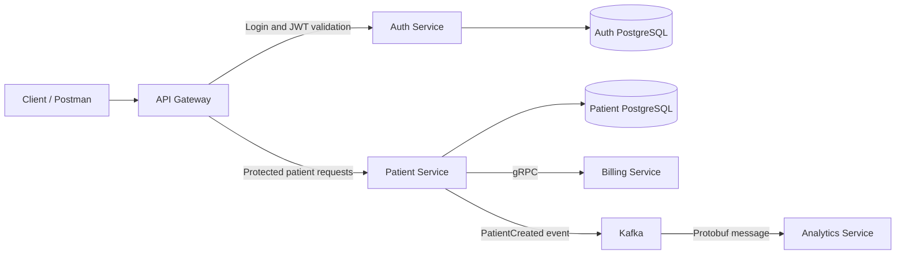

# Patient Management System


A patient management backend built with Spring Boot microservices. It combines REST APIs, JWT authentication, gRPC communication, and Kafka events, with Docker Compose for local development and AWS CDK infrastructure for LocalStack.

## Architecture



1. The client logs in through the gateway and receives a JWT.
2. The gateway validates the token with Auth Service before forwarding patient requests.
3. Creating a patient saves the record, calls Billing Service over gRPC, and publishes a Protobuf event to the `patient` Kafka topic.
4. Analytics Service consumes and logs the event.

## Services

| Module | Responsibility |
| --- | --- |
| [Patient-Service](Patient-Service) | Patient CRUD, request validation, PostgreSQL persistence, and billing/event integration. |
| [Auth-Service](Auth-Service) | User storage, BCrypt password verification, and JWT generation and validation. |
| [API-Gateway](API-Gateway) | Request routing, JWT validation for patient routes, and OpenAPI forwarding. |
| [Billing-Service](Billing-Service) | A gRPC billing account example that returns an account ID and status. |
| [Analytics-Service](Analytics-Service) | Consumes and logs patient events from Kafka. |
| [Infrastructure](Infrastructure) | Java AWS CDK definitions and a LocalStack deployment script. |
| [Integration-Tests](Integration-Tests) | JUnit 5 and REST Assured tests for login and protected patient requests. |

**Stack:** Java 21, Spring Boot, Spring Cloud Gateway, Spring Data JPA, PostgreSQL, Spring Security Crypto, JWT, Kafka, gRPC, Protocol Buffers, Maven, Docker, AWS CDK, and LocalStack.

## Run locally

Requirements: Docker with Docker Compose, Git, and OpenSSL. Java 21 is needed to run the integration tests; the service images build with Maven inside Docker.

```bash
git clone https://github.com/y0ussefmohamed/Patient-Management-System.git
cd Patient-Management-System

# Generate a local JWT signing secret without overwriting an existing .env file.
test -f .env || printf 'JWT_SECRET=%s\n' "$(openssl rand -base64 32)" > .env

docker compose up --build -d --wait
```

The API gateway is available at **http://localhost:8084**. Compose starts the five services, two PostgreSQL databases, and Kafka, and creates the `patient` topic automatically. The generated `.env` file is ignored by Git.

Useful commands:

```bash
docker compose ps
docker compose logs -f analytics-service
docker compose down
```

Database data persists between restarts. Patient data uses `~/db_volumes/patient-service-db`; Auth data uses the `auth-db-data` Docker volume.

## Try the API

Use Postman with `http://localhost:8084` as the base URL.

### 1. Log in

Send **POST `/auth/login`** with a raw JSON body and `Content-Type: application/json`:

```json
{
  "email": "testuser@test.com",
  "password": "password123"
}
```

These are the seeded local demo credentials. A successful response contains a `token` field.

### 2. Call a protected endpoint

In Postman's **Authorization** tab, select **Bearer Token** and paste the returned token. Then send **GET `/api/patients`**. A valid token returns `200 OK`; a missing or invalid token returns `401 Unauthorized`.

To create a patient, send **POST `/api/patients`** with the same authorization and a raw JSON body:

```json
{
  "name": "Demo Patient",
  "email": "demo.patient@example.com",
  "address": "123 Example Street",
  "dateOfBirth": "1995-06-15"
}
```

A successful creation returns `201 Created`. Use a unique email for each new patient. The resulting Kafka event appears in the Analytics Service logs.

### Endpoints

| Method | Gateway path | Purpose | JWT required |
| --- | --- | --- | --- |
| POST | `/auth/login` | Log in and receive a token | No |
| GET | `/auth/validate` | Validate a token | Yes |
| GET | `/api/patients` | List patients | Yes |
| POST | `/api/patients` | Create a patient | Yes |
| PUT | `/api/patients/{id}` | Update a patient | Yes |
| DELETE | `/api/patients/{id}` | Delete a patient | Yes |

OpenAPI specifications are available through the gateway at [`/api-docs/patients`](http://localhost:8084/api-docs/patients) and [`/api-docs/auth`](http://localhost:8084/api-docs/auth).

## Integration tests

With the Compose stack running and Java 21 installed:

```bash
cd Integration-Tests
./mvnw test
```

The tests call the gateway at `http://localhost:8084` and cover valid login, invalid login, patient access with a valid token, and rejection of missing or invalid tokens.

## LocalStack deployment

The [Infrastructure](Infrastructure) module defines a VPC, ECS/Fargate services, two PostgreSQL RDS instances, an MSK Kafka cluster, and an Application Load Balancer in Java using AWS CDK. This setup targets local AWS emulation with LocalStack.

To use it, run LocalStack with support for these services and install the AWS CLI. Build the Docker images with the names used by the stack:

```bash
docker build -t auth-service ./Auth-Service
docker build -t billing-service ./Billing-Service
docker build -t analytics-service ./Analytics-Service
docker build -t patient-service ./Patient-Service
docker build -t api-gateway ./API-Gateway
```

Stop the Compose stack before using LocalStack, since the deployments use overlapping ports. In IntelliJ, run `com.pms.stack.LocalStack` with `Infrastructure` as the working directory to generate `cdk.out/localstack.template.json`. Then, from the repository root, deploy with local AWS CLI credentials configured:

```bash
bash Infrastructure/localstack-deploy.sh
```

The script reads `JWT_SECRET` from the root `.env` file and prints the gateway URL. Use that URL in Postman in place of `http://localhost:8084`.
